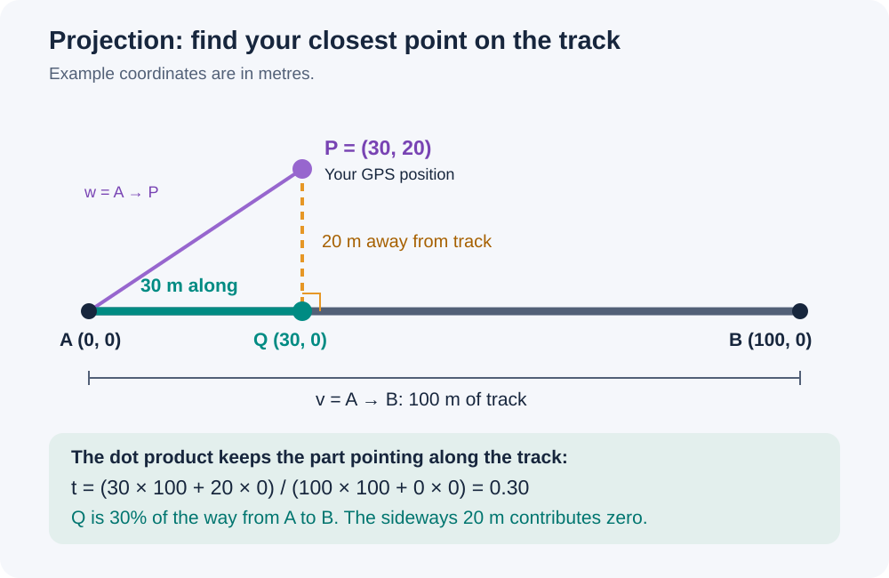
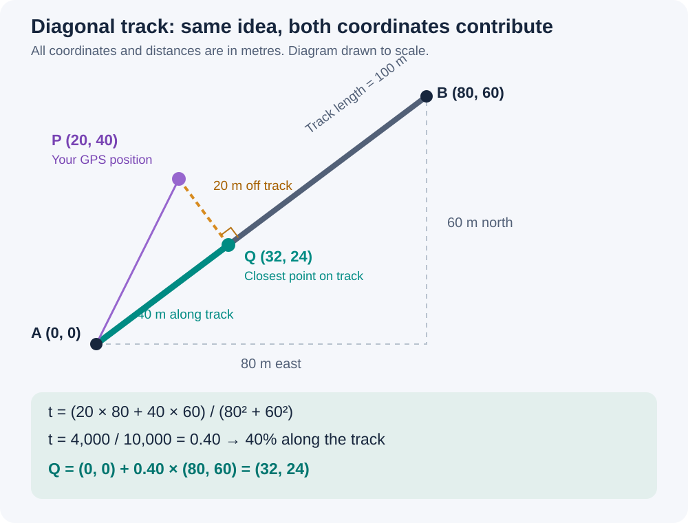

# CANTRE learning journal

## Lesson 1 — GPS projection, calibration anchors and track choice

Session: October 20, 2026. Status: worked mathematical examples and agreed design direction; no tracker implementation or field accuracy validation in this lesson. All coordinates are synthetic, in metres.

### The question

How do we turn a GPS position into a position along a railway, then into subdivision and milepost?

Keep three steps separate:

1. Project the measured position onto candidate track segments.
2. Resolve which route/track the user is on.
3. Use qualified calibration anchors to convert along-track position to milepost.

### What projection means

A projection finds the closest point Q on a straight track segment A–B to a measured point P. Think of dropping a perpendicular from P onto the track. If that perpendicular lands beyond an endpoint, the endpoint is the closest point on the finite segment.

It provides a fraction along the segment and the distance from the measured position to that segment. It does not by itself identify the correct track or establish milepost accuracy.

### Example 1 — horizontal track



- A = (0, 0), B = (100, 0), P = (30, 20).
- Q = (30, 0): 30 metres along, 20 metres away from the track.
- The fraction along the segment is 30 / 100 = 0.30.

### The formula

A vector describes movement, with an east component and a north component. Subtract coordinates to obtain movement relative to the segment start:

```text
v = B − A       track vector
w = P − A       GPS position relative to A

w · v = w.x × v.x + w.y × v.y       dot product

t_raw = (w · v) / (v · v)
t = max(0, min(1, t_raw))           keep the result on the segment
Q = A + t × v
distance = sqrt((P.x − Q.x)² + (P.y − Q.y)²)
```

The dot product measures alignment with the track vector. Dividing by the track's squared length gives a dimensionless fraction. The two dot products have units of square metres; their ratio has no distance unit.

If A and B coincide, the denominator is zero. Treat that degenerate segment separately, using A as the closest point or rejecting it under an explicit data policy. Never divide by zero.

### Example 2 — diagonal track, step by step



Given A = (0, 0), B = (80, 60), P = (20, 40):

1. Track vector: v = (80, 60). GPS vector: w = (20, 40).
2. Dot product: w · v = 20 × 80 + 40 × 60 = 1,600 + 2,400 = 4,000.
3. Squared track length: v · v = 80² + 60² = 6,400 + 3,600 = 10,000.
4. Fraction: t = 4,000 / 10,000 = 0.40. It is already between 0 and 1.
5. Closest point: Q = (0, 0) + 0.40 × (80, 60) = (32, 24).
6. Offset: P − Q = (−12, 16). Distance = sqrt(144 + 256) = 20 metres.
7. Track length = sqrt(10,000) = 100 metres. Q is 0.40 × 100 = 40 metres along.

Both coordinate components contribute because the track is diagonal. P–Q is perpendicular to this segment: (−12 × 80) + (16 × 60) = 0.

These calculations use a local planar coordinate system in metres. Raw latitude/longitude degrees must first be handled with an appropriate coordinate transformation; they are not interchangeable with these metre coordinates. For a curved track represented by a polyline, project onto its segments and sum preceding segment lengths to obtain distance along the route. Do not substitute the straight endpoint-to-endpoint distance for curved path length.

### Can crossings improve the milepost calculation?

Yes. A crossing, bridge, switch or surveyed point may be a calibration anchor if its physical location, route/track association and railway milepost are reliable.

- Coordinates alone can help check map geometry; they do not independently establish a milepost.
- Coordinates plus a verified milepost connect physical position to railway mileage.
- Check what physical point the coordinates identify and whether the milepost was surveyed, rounded or estimated.
- A milepost generated by our own algorithm is not independent validation of that algorithm.

For example, a verified crossing at MP 10.4 between markers MP 10.0 and MP 11.0 allows separate interpolation over 10.0–10.4 and 10.4–11.0, using distance along the track. Additional anchors may improve local calibration, but do not guarantee accuracy. Do not interpolate across mileage discontinuities or outside qualified anchor coverage.

### What if multiple tracks are nearby?

Projection is repeated for each nearby candidate segment. Suppose distances from a GPS fix are 4 m, 7 m and 45 m. The nearest candidate is not automatically the correct track: with roughly 10 m GPS uncertainty, the first two may both be plausible. These are illustrative numbers, not chosen production thresholds.

Candidate evaluation can consider GPS uncertainty, freshness, direction of movement, connected track continuity, previous positions and explicit user selection. Direction helps at diverging routes but may not distinguish parallel tracks or stationary positions.

**User-confirmed design direction:** when multiple tracks remain plausible, state the ambiguity and ask which track/route the user is on before presenting a resolved track-specific result.

Example proposed UI wording:

> More than one track matches your location. Which track or route are you on?

Show understandable candidate labels and map highlights. Keep the selected route/track visibly locked; do not silently switch it. A choice resolves intended route identity, not GPS precision. Stale fixes or conflicts with the selected route must remain visible rather than producing a confident current result. Exact candidate thresholds and UI behavior remain to be implemented and tested.

### Where we paused

Completed: horizontal and diagonal examples, dot product explanation, anchor discussion and the ambiguity decision. No app code was added during this lesson.

Next learning step: translate the small projection calculation into code together, explaining each line; check an interior point, a point beyond an endpoint and a zero-length segment. Continue only at the agreed teaching pace.

### Provenance and sharing

These notes summarize the owner–assistant learning session dated October 20, 2026. The diagrams are original synthetic teaching examples. They contain no real GPS traces or employer railway datasets. Research repository: https://github.com/orgonag/cantre-research (access depends on repository permissions).

This lesson is maintained in the private research repository for invited collaborators. It does not authorize a public website or a change in repository visibility. Keep the Markdown and images together when exporting.
