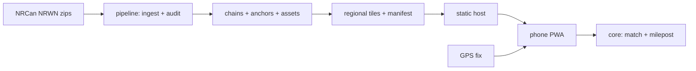

# CANTRE v1 — design specification

**CANTRE — Canada Track Rail Estimation.** Status: proposed for owner review, 2026-10-23.
This spec supersedes the proposals in [IMPLEMENTATION.md](../../IMPLEMENTATION.md) where they
differ (Leaflet, Cloudflare R2), replaces the stages in [PLAN.md](../../PLAN.md) with the
milestones in §13, and turns the research handoff into a buildable v1. It does
not describe built software. Everything below is a plan until a PR implements and tests it.

## 1. Purpose

A free, open-source research tool that helps anyone work out **where they are on the
Canadian railway network** and **what railway assets are near them**, using only public data
and processing location on the device. It is also a reproducible research artifact that is
suitable for a National Research Council Canada submission. It ships with a methods write-up,
an evaluation report and full data provenance.

**Audience:** rail researchers, railfans, municipal and emergency planners, students, and
rail workers who want a second, non-authoritative reference.

**Success for v1:**

1. On a phone browser, a user with a GPS fix near NRWN main track sees: the plausible
   subdivision, track, operator, a calculated milepost **or an explicit reason it is
   unavailable**, and the nearest crossings, bridges, tunnels, stations and diamonds, each
   with its along-track distance.
2. Every number on screen can be traced to a dataset version, a method and an uncertainty
   statement.
3. Coverage spans every province and territory published in NRWN. Calibration coverage is
   reported per subdivision instead of being assumed.
4. A published evaluation report measures internal consistency (leave-one-anchor-out) and
   coverage. It does not present those figures as surveyed accuracy.
5. The repo is release-ready: licence, attribution, citation file, contribution guide, CI,
   bilingual UI and an accessibility pass. Making it public and deploying it remain
   owner-gated (§12).

**Non-goals for v1:** operational use, movement authority or safety functions of any kind;
LRT and transit networks; US coverage; dead reckoning; trace recording or upload; native app
stores; a backend server.

## 2. Principles

These come from the research docs and are binding on implementation.

- **Honest outputs.** A null milepost is never shown as zero. Do not extrapolate beyond the
  outer anchors, bridge topology gaps, or interpolate across a mileage discontinuity. Keep
  ambiguity visible. A user choice changes the candidate set and never improves GPS precision.
- **Separate quantities.** Device accuracy, cross-track residual, along-track position,
  calculated milepost, interpolation uncertainty and candidate ambiguity are displayed and
  stored as separate fields.
- **Privacy by construction.** Location stays on the device. There is no analytics, no
  telemetry and no server. Tile requests reveal approximate area to the static host; the app
  discloses this and offers whole-province prefetch to blur it.
- **Provenance everywhere.** Every bundle traces to raw source bytes (URL, licence, SHA-256,
  retrieval UTC time, package version, CRS) and to the pipeline version and configuration
  that produced it.
- **Independent authorship.** No code or data from TrackPilot, the archived original app or
  any private reference.

## 3. Data sources

| Source | Use | Licence | Status |
|---|---|---|---|
| NRCan National Railway Network (NRWN) 2.0, GeoBase, per-province SHP (English) | Track geometry, subdivisions, operators, anchors, assets | Open Government Licence – Canada | Primary. Packages dated 2019-07-25; feature revisions mostly 2016. |
| OpenFreeMap public vector tiles (OpenStreetMap data) | Basemap only, never used in calculation | ODbL data, attribution required | Default basemap. A public best-effort service. |

**Observed NRWN 2.0 schema (Ontario package, inspected 2026-10-23):**

- `TRACK` (19,055 segments): `NID`, `TRACKSEGID`, `TRACKCLASS` (Main/Siding/Spur/Yard…),
  `STATUS`, `OPERATOENA`/`OPERATORMK`, `OWNERENA`, `SUBDI1NID`/`SUBDI1NAME`, `SUBD1START`/
  `SUBD1END` (these look like subdivision extents, not per-segment mileage; to be verified),
  `USETYPE`, and `GEO*`/`ATT*` provenance fields.
- `CROSSING` (12,718): `TRACKNID`, `SUBDI1NID`, `SUBD1DIST` (mileage, `-1` sentinel),
  `SUB1UNITDI` (Mile), `SUB1DISTY` (`Posted` ×8,747 / `Unknown`), `LEVELCROSS`,
  `CROSSINTYP`, `WARNINGSYS`, `TCID` (Transport Canada ID).
- `MARKERPOST` (3,867): mileage values present, but `SUB1DISTY` is `Unknown` for 3,745 of them.
- `STATION` (671): `SUBD1DIST` with `Posted` on all records.
- `STRUCTURE_0` (point: culverts, tunnels) and `STRUCTURE_1` (line: bridges, tunnels,
  moveable bridges). Some have Posted mileage.
- `JUNCTION` (14,981): `TRAJUNCTYP` Switch/End/Administrative/**Diamond** (41 in Ontario).
- CRS: NAD83(CSRS98) geographic. `GEOACCURA` is mostly `10`; its unit and meaning are
  unverified until checked against the NRWN data product specification (task in M2).

**Datum note.** Phone GNSS reports WGS 84 (realised close to ITRF). NAD83(CSRS) differs from
it by roughly 1–2 m across Canada, varying with location and epoch. v1 applies no
transformation and reports the offset as a known, bounded bias. M5 quantifies it.

## 4. Architecture

Approach A: an offline-first static web app. Everything runs either in a reproducible build
pipeline or on the device.



Monorepo layout:

| Path | Unit | Language | Depends on |
|---|---|---|---|
| `pipeline/` | Ingest, audit, chain building, anchor qualification, tiling, manifest, reports | Python 3.12 | `pyshp` (MIT); `geographiclib` (MIT) for tests |
| `packages/core/` | Pure calculation: geodesy, projection, chain math, interpolation, matching state machine | TypeScript, zero runtime deps | — |
| `packages/data-client/` | Manifest and tile loading, cache, version pinning | TypeScript | core types |
| `app/` | PWA UI: map, status card, assets, route chooser, search, settings, i18n | TypeScript + Preact + MapLibre GL JS, built with Vite | core, data-client |
| `eval/` | Leave-one-anchor-out and synthetic scenario harness, report generator | TypeScript (Node) | core |
| `docs/` | Research docs, METHODS.md, EVALUATION.md (generated), DATA.md | Markdown | — |

Each unit has one job, a typed interface and its own tests. `core` never touches the DOM,
the network or storage, so the app, the evaluation harness and the tests all share it.
Exact dependency versions are pinned at plan time to current stable releases, and their
licences are re-checked.

## 5. Pipeline (`pipeline/`)

1. **Acquire.** Download each province's `nrwn_rfn_<pr>_shp_en.zip`. Write
   `sources/<pr>.json` with URL, HTTP date, size, SHA-256, retrieval UTC time and member
   checksums. Raw bytes are cached outside git. In CI, a fixed cache key forces
   re-verification of the hashes.
2. **Parse and validate.** Read the DBF and SHP directly. Check unique IDs, sentinels
   (`-1`, `None`, `Unknown`), units, multipart geometry and coordinate ranges. Every rejected
   record is written to an audit file with a reason code. Nothing is dropped silently.
3. **Build chains.** A *chain* is an ordered, connected run of track segments that share
   `SUBDI1NID` and track class `Main`. Segments are linked through shared endpoints (exact
   match after a documented 1e-7° snap) and through `JUNCTION` points. A branch, a gap or a
   double track produces separate chains; gaps are never bridged. Each vertex stores a
   cumulative distance `s` (metres). Sidings, spurs and yards are kept as unchained
   segments: they can still be matched for subdivision and asset context, but carry no
   milepost in v1.
4. **Qualify anchors.** Anchors come from CROSSING, STATION, STRUCTURE and MARKERPOST records
   on the same `TRACKNID`/subdivision as the chain. An anchor is accepted when: qualifier =
   `Posted`, unit = `Mile`, value ≥ 0 and not a sentinel, and its projection residual onto
   the chain ≤ `anchorMaxResidualM`. The default of 25 m is inherited from the pilot and
   labelled experimental. Each anchor is projected to `(chainId, s)`. NRWN stores one crossing
   record per track; records on the same chain that share `CROSSINGID` and agree in value
   are merged, and records on other chains stay separate.
   Anchors that conflict are flagged and excluded.
5. **Find discontinuities.** Along each chain, anchors sorted by `s` must have monotonic
   mileage (either direction) and a plausible slope: |ΔMP·1609.344 / Δs − 1| ≤
   `slopeTolerance`, default 0.15, experimental. Where a pair breaks monotonicity, the chain
   splits into *calibrated intervals*. A single outlying anchor is excluded and reported.
   The milepost is never interpolated across a split.
6. **Extract assets.** Crossings (with level, type, warning system, TCID), bridges, moveable
   bridges, tunnels, stations and diamond junctions, each with source mileage if Posted and a
   derived chain position if projectable. *Derived* and *posted* mileage are kept as
   separate labelled fields. Culverts are stored but not shown as bridges.
7. **Tile.** Build a fixed grid of 0.25° latitude × 0.5° longitude. Each tile contains every
   chain piece, segment and asset intersecting the tile plus a 2 km buffer, keyed by stable
   IDs so that pieces duplicated across tiles reassemble exactly. Coordinates are stored as
   delta-encoded integer microdegrees (1e-6° ≈ 0.11 m north–south, finer east–west), with the
   precision documented and tested. The tile format is JSON, served compressed by the host.
8. **Manifest.** `manifest.json` holds the dataset version (`nrwn-2.0+cantre.<pipelineVersion>`),
   source hashes, configuration, per-tile hash, size and bounds, and per-province totals.
   The app refuses to mix tiles from different dataset versions.
9. **Reports.** Per-subdivision coverage: km of chain, km inside calibrated intervals, anchor
   counts by source layer, rejected counts by reason. These feed EVALUATION.md.

Determinism: the same raw hashes plus the same configuration give byte-identical outputs,
and CI checks this on a bundled synthetic fixture and one real province.

## 6. Calculation core (`packages/core/`)

**Geodesy.** Segment-local tangent-plane approximation on the GRS80 ellipsoid. East–west
scale is N(φ)·cos φ and north–south scale is M(φ), evaluated at the segment's mid-latitude.
Geodesic distance uses the same scheme. Python (pipeline) and TypeScript (core) implement it
identically, and both are cross-checked against GeographicLib in tests. Target: < 1 mm error
on segments ≤ 2 km. Longer segments are subdivided for distance only, which adds no fake
curvature.

**Projection.** For a fix P and each candidate segment AB, compute the clamped projection
fraction t, the projected point Q, the cross-track residual |PQ| (m) and the along-chain
position s = s_A + t·|AB|. Zero-length segments are point candidates. Non-finite input is
rejected. This follows the worked math in [PROJECTION.md](../../PROJECTION.md).

**Milepost.** Find the bracketing anchors (s₁, MP₁) and (s₂, MP₂) inside a single calibrated
interval and compute MP = MP₁ + (s − s₁)/(s₂ − s₁)·(MP₂ − MP₁). Outside the outer anchors,
or across a split, the result is `UNCALIBRATED` with a reason code. Kilometre output comes
from an explicit conversion (1 mi = 1.609344 km).

**Uncertainty shown.** (a) Device accuracy radius as reported. (b) Cross-track residual.
(c) *GPS-propagated MP band*: ± accuracy × |MP₂ − MP₁|/(s₂ − s₁), labelled "from GPS
accuracy only". (d) Interval length, which tells the user how far apart the calibration
points are. (e) The source's stated accuracy, once verified. These are never combined into
a confidence interval.

**Matching state machine.** Inputs are fix events `{lat, lon, timestamp, accuracyM,
headingDeg?, speedMps?}` and user actions. Output is a `Result` carrying `status`, candidate
list, chosen chain and track, `s`, `mp | null`, `mpBand`, the anchor IDs used,
`selectionOrigin` (`auto`/`user`), `reasons[]`, `fixAgeMs` and `datasetVersion`.

| Status | Meaning |
|---|---|
| `NO_PERMISSION`, `NO_FIX` | Location unavailable; the reason is shown. |
| `STALE` | Newest fix is older than `staleAfterMs` (default 15 s). The last result is shown as historical. |
| `NO_COVERAGE` | No tile loaded or none exists for the area. |
| `OFF_NETWORK` | No candidate within the search radius max(50 m, 3 × accuracy). |
| `AMBIGUOUS_ROUTE` | Candidates on different subdivisions or operators are indistinguishable: within d_min + max(accuracy, 10 m). The user must choose. |
| `MATCHED_SUBDIVISION` | One subdivision, several indistinguishable tracks. If every candidate track's MP agrees within the MP band, the MP is shown as a range; otherwise none is shown. |
| `MATCHED` | One supported chain. The MP is shown if calibrated. |
| `LOCK_CONFLICT` | The user locked a route and fresh evidence no longer supports it. The lock stays visible, no current MP is shown, and an unlock is offered. |

Rules: a diamond junction within the search radius, or a sole candidate in a partly loaded
tile, blocks automatic selection. Heading is used only when speed > 3 m/s
(experimental), and is direction-agnostic. Continuity gives the previously matched chain a
documented preference, but it can never override a contradiction for longer than
`continuityMaxMs`. Fixes that arrive out of order or are older than the current state are
ignored. A lock persists for the session and is always shown; there is no silent switching.
Every numeric threshold lives in one config object, is labelled *experimental* and is
reported by the evaluation (§9).

**Research matcher (eval only).** An HMM map matcher (Newson & Krumm 2009 formulation) is
implemented in `eval/` so it can be compared with the rule-based matcher on synthetic and
authorised traces. It is not used in the app unless the evaluation justifies it.

## 7. App (`app/`)

Illustrative layout (values invented):

```text
┌──────────────────────────────────────────┐
│ CANTRE                      EN|FR [gear] │
│                                          │
│         map: tracks, assets, you         │
│                                          │
├──────────────────────────────────────────┤
│ Kingston Sub · CN · Main     [auto lock] │
│ MP 112.43   ± 0.01 mi from GPS only      │
│ fix 2 s · ±6 m · off-track 3.1 m         │
│ anchors 112.10 → 112.52 · NRWN 2016      │
├──────────────────────────────────────────┤
│ ahead   Crossing Hwy 15  0.31 mi  112.74 │
│ behind  Bridge           0.48 mi  111.95 │
│ ahead   Diamond (CP)     1.20 mi  —      │
└──────────────────────────────────────────┘
```

- **Status card:** subdivision, operator, track class, MP or an explicit reason, the
  uncertainty fields from §6, the anchors used, data vintage, and a lock chip showing
  `auto`/`locked`.
- **Nearby assets:** sorted by along-chain distance ahead and behind, with type filters.
  Posted and derived mileage are labelled differently. Tapping an asset opens its source
  attributes.
- **Route chooser:** appears on `AMBIGUOUS_ROUTE`. Lists candidates with operator,
  subdivision and residual. The chosen route locks; the lock is cleared explicitly.
- **Find a location:** pick a subdivision and enter an MP to place a pin, or tap the map to
  compute the MP of a point. This works without GPS, which suits research and desk use.
- **Offline:** a service worker caches the app shell. Users can download provinces under
  Settings → Offline data, which shows sizes. Tiles already in use are pinned to their
  dataset version.
- **Settings and about:** miles/km, EN/FR, a privacy explainer (what leaves the device),
  methods, data sources, licences and attribution, and the research-use disclaimer.
- **Accessibility:** targets WCAG 2.2 AA. A text-first status card, an ARIA live region that
  announces MP changes at most every 10 s, full keyboard use and sufficient contrast in light
  and dark themes. The map is never the only way to get information.
- **i18n:** every string goes through a message catalogue (en, fr). Attribute codes are
  translated in the app; proper names stay as published.

## 8. Error handling

Every failure is a typed reason code with an EN/FR message: permission denied,
geolocation timeout, tile fetch failure (offline cache used if present), manifest version
mismatch, corrupt tile (hash mismatch, so it is rejected), no coverage, uncalibrated,
discontinuity, ambiguous route, lock conflict and stale fix. No exception reaches the user
as a blank screen; the app has an error boundary with a reset. The pipeline fails loudly on
a schema drift or a hash mismatch.

## 9. Testing and evaluation

- **Core:** Vitest unit tests for every case in [ACCEPTANCE.md](../../ACCEPTANCE.md);
  fast-check property tests (projection residual ⟂ segment, monotonic s, interpolation
  reproducing anchors, no NaN escaping); GeographicLib golden tests for geodesy.
- **Pipeline:** pytest on synthetic fixtures (gaps, double track, discontinuity, duplicate
  crossings, sentinels); a determinism test (hash equality); and a smoke run on one real
  province in CI.
- **Scenarios:** replayable synthetic traces covering a diamond approach, standstill and
  departure; parallel Class I lines; a double track; a stale or out-of-order fix; a lock
  conflict; and a tile boundary crossing. Each asserts the status sequence.
- **App:** Playwright with mocked geolocation on mobile viewports. Network assertions prove
  no request carries coordinates and only tile and manifest URLs are fetched. Storage
  assertions prove no trace persists. axe accessibility checks run in CI.
- **Evaluation report (`docs/EVALUATION.md`, generated):** per-province coverage;
  leave-one-anchor-out residuals (predicted MP minus withheld posted MP, in metres and in
  miles) with their distributions; and the matcher comparison on synthetic scenarios. The
  report states plainly that these measure internal consistency, not surveyed accuracy.
  Independent field validation stays an open item.

## 10. Methods write-up

`docs/METHODS.md` is written in paper style for the NRC submission. It covers the problem,
data and provenance, geodesy, chain construction, anchor qualification, interpolation,
matching and ambiguity policy, the uncertainty model, the evaluation design and results, the
limitations (2016 vintage, datum, unverified `GEOACCURA`, Unknown-qualified marker posts,
no independent truth), and references. Figures are generated from synthetic examples.

## 11. Release kit

- `LICENSE`: MIT for code. `DATA-LICENSES.md` carries the OGL-Canada attribution ("Contains
  information licensed under the Open Government Licence – Canada") and OSM/ODbL basemap
  attribution, which also appear in the app's About page and the map corner.
- `README.md` (EN/FR summary), `CITATION.cff`, `CONTRIBUTING.md`, `CODE_OF_CONDUCT.md`,
  `SECURITY.md` and `CHANGELOG.md`.
- GitHub Actions run lint, typecheck, unit, property, pipeline, determinism, Playwright and
  axe on every PR. A build workflow produces the site plus data tiles as an artifact. The
  deploy-to-Pages workflow exists but is `workflow_dispatch` only.
- Size budget: app shell < 300 kB gzipped excluding the map library; each tile < 500 kB
  compressed. The national total is reported in the manifest.

## 12. Owner-gated steps

These are prepared but never done without Orgo's explicit go-ahead: making the repo public;
enabling GitHub Pages (which needs a public repo on the free plan) and running deploy;
announcing or submitting to NRC; adopting any non-NRWN data source.

## 13. Milestones (input to the implementation plan)

| # | Milestone | Done when |
|---|---|---|
| M1 | Core geodesy, projection and interpolation | ACCEPTANCE geometry/anchor cases, property tests and GeographicLib goldens pass. |
| M2 | Pipeline for one province (SK, the pilot) end to end | Deterministic tiles, manifest, audit and coverage report; `GEOACCURA` meaning verified from the spec. |
| M3 | Matching state machine and scenarios | Every status in §6 is reachable and asserted by scenario replays. |
| M4 | App MVP on SK data | Status card, assets, chooser and lock, find-a-location, EN/FR; Playwright, privacy and axe pass. |
| M5 | National pipeline, offline downloads, evaluation | All NRWN provinces built; EVALUATION.md generated; datum offset quantified. |
| M6 | Methods write-up and release kit | METHODS.md, licences, CITATION, CI green, deploy workflow ready but not run. |

## 14. Risks and open questions

- NRWN feature vintage is mostly 2016: abandonments, new sidings and renamed subdivisions
  will be wrong. Vintage is shown everywhere.
- Calibrated coverage may be thin where few crossings are Posted. The coverage report will
  show this; Unknown-qualified marker posts are tested only as an *experimental* anchor class
  in the evaluation, never in the app by default.
- The meaning of `SUBD1START`/`SUBD1END` (subdivision extent vs. segment mileage) needs
  verification. If they turn out to be segment-level, they become a second anchor class
  after evaluation.
- OpenFreeMap is best-effort. Fallback: the app still works with no basemap (tracks and
  assets only), and self-hosted PMTiles is a later option.
- The 1% metric definition from the research log stays unresolved. v1 does not claim it.
